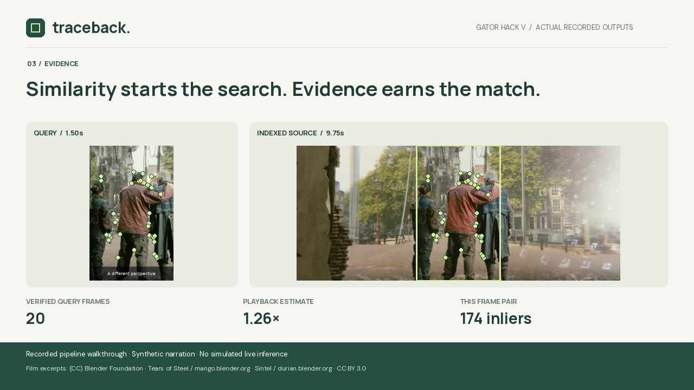

# Traceback

**Find the source behind an edited video. Inspect the evidence.**

[Interactive demo](https://enteragoodusername.github.io/traceback-gatorhack/) · [2:15 walkthrough](https://enteragoodusername.github.io/traceback-gatorhack/demo/) · [Sample evidence packet](https://enteragoodusername.github.io/traceback-gatorhack/downloads/traceback-evidence.zip)



*An evidence visualization from a real local run; not a simulated app screenshot.*

Traceback is a local video provenance workbench built for Gator Hack V 2026.
It combines the January 2026 **Qwen3-VL-Embedding-2B** model with geometric
verification and temporal alignment. A crop, color grade, mirror, or playback
change can preserve enough visual evidence to recover an indexed source.

The application returns matching frame pairs, source timestamps, an estimated
playback transformation, and a downloadable evidence packet. It also searches
your source library using visual descriptions rather than filenames.

**A match establishes shared imagery with an indexed source. It does not
establish ownership, infringement, intent, or first publication.**

## Run it

Prerequisites: Linux, Python 3.11 (tested), Node.js 22+, FFmpeg, approximately 8 GB
of available memory, and 8 GB of free disk space. The first model download is approximately 4.4 GB. This
build was tested on an Intel i7-1165G7 laptop CPU without a GPU.

```bash
./setup.sh
./start.sh
```

Open **http://127.0.0.1:8000**. Setup installs dependencies, builds the interface,
and creates the source index. Python dependencies are pinned with hashes in
`requirements.lock`; the CPU wheels come from the official PyTorch index and
other packages from PyPI. Subsequent starts use the existing index and
model cache.

For the interface and recorded examples only:

```bash
npm ci
npm run build
npm run preview
```

The hosted interface uses **recorded outputs from actual pipeline runs**.
It does not pretend to execute a model in the browser. Start the local server
to analyze a new upload, add your own source, run a demo live, or enter an
arbitrary semantic search. Recorded search suggestions also contain actual
model outputs.

## A useful first demo

1. Select **The cropped repost** and choose **Find the source**.
2. Inspect the recovered source, timing estimate, and matching green features.
3. Select different frame pairs and inspect the source video.
4. Export the evidence ZIP, then open **Verify a packet** to check every included
   checksum and inspect its frame pairs locally in the browser.
5. Try the unrelated clip. The system should abstain when it cannot verify a
   source in this library.
6. In **Source library**, search a visual description. On the local server,
   add an original source and trace a new edited version of it.

When connected locally, **Run this demo live on my computer** sends the
selected example through the same upload endpoint used for new clips. CPU
processing can take roughly a minute or longer, depending on clip length and
concurrent work. Progress messages report the actual processing stage.

Completed uploads and evidence remain in `data/uploads/`. The local interface
can reopen its latest analysis after a refresh, including a still-running job.
The browser stores only the job ID. Dismissing the link does not delete files;
local data stays until you remove it. A server restart preserves completed
reports, but does not resume an interrupted computation.

## Command-line workflow

The same measured engine is available without a browser:

```bash
.venv/bin/python -m server.cli library
.venv/bin/python -m server.cli search "Two people beside a canal"
.venv/bin/python -m server.cli analyze my-edited-clip.mp4 --output artifacts/my-trace
.venv/bin/python scripts/export_packet.py artifacts/my-trace/report.json artifacts/my-evidence.zip
python3 scripts/verify_packet.py artifacts/my-evidence.zip
```

Use an empty output directory to preserve earlier evidence. `--visual-only`
skips semantic inference and is explicitly labeled in the report. A source
index is still required. The `Two stories, one edit` example demonstrates
multiple verified source intervals within a single query.

## What is new enough for the challenge?

Gator Hack's released challenge, **Fresh off the frontier**, requires a
technology, dataset, or discovery first made public within the preceding
12 months to be central to the project.

Traceback uses **Qwen3-VL-Embedding**, a distinct multimodal retrieval model
released in January 2026. Its model repository was created January 7, 2026.
The older Qwen3-VL base model is not the recency claim. The embedding model
encodes source frame pixels and text into a shared 2,048-dimensional space.
It powers semantic library search and ranks candidate sources for verification.

- [Released hackathon challenge](https://ufgatorhack.com/data/challenge.json)
- [Qwen3-VL-Embedding model](https://huggingface.co/Qwen/Qwen3-VL-Embedding-2B)
- [January 2026 technical report](https://arxiv.org/abs/2601.04720)
- [Pinned model revision](https://huggingface.co/Qwen/Qwen3-VL-Embedding-2B/tree/9f2f7e710d6d81056aa5c0a4f04764fec6bb7bda)

## How it works

1. **Index the source.** Sample visual frames, extract ORB descriptors, and
   compute Qwen embeddings from pixels. Source titles and captions never enter
   the embedding inputs.
2. **Retrieve candidates.** Embed sampled query frames and compare them with
   source vectors. In this small demonstration, all sources remain eligible
   for verification, in semantic rank order.
3. **Verify appearance.** Require unique feature correspondences, a consistent
   RANSAC homography, sufficient spatial coverage, and correlated image content
   after alignment. A shared logo or a few matching corners are insufficient.
4. **Estimate time.** Fit multiple timestamp hypotheses with one vote per query
   frame. A denser 4 fps pass refines supported sources. Competing timing
   explanations and weak speed estimates remain explicit.
5. **Export evidence.** Include the model revision, engine fingerprint, media
   hashes, matching points, source intervals, and inspected frame images.

The source sample rate starts at 1 fps and query sampling at 2 fps. The refined
timing pass samples supported sources at 4 fps. Tolerances and consistency
ranges are algorithm settings, **not calibrated confidence intervals**.

## Evaluation

The **Under the hood** page displays the measured evaluation and every
individual case. The machine-readable record is
[`public/evaluation.json`](public/evaluation.json).

The separately seeded, frozen-engine evaluation recovered **32/32 edited
sources** and rejected **8/8 negative clips**, with **zero false source matches**.
Qwen ranked the correct source first for all 32 positive clips. The public record
includes every case, start-time and playback-speed errors, the seed, and the
hardware context. A plot shows the full timing-error distribution rather than
only an aggregate score.

An earlier development suite exposed coarse timing errors and motivated the
4 fps refinement. The final suite uses a new seed, with the core engine held
unchanged throughout its run. It uses the same four source excerpts with new
edit instances, not unseen source works.

These are small, controlled tests on openly licensed films with synthetic
edits. They are not an internet-scale accuracy claim. Timing error summaries
include only recovered sources. Abstentions and false matches are reported
separately. A separate [live ingestion check](public/validation/live-ingestion.json)
uploaded a new Sintel source, indexed it, searched it, and recovered a cropped,
mirrored, speed-changed query over the actual HTTP API. This one additional
workflow test is reported separately from the four-source evaluation.

Full benchmark outputs stay under `artifacts/benchmarks/` locally
and are excluded from the repository because they contain redundant media.

```bash
# Original media is needed only to regenerate fixtures or benchmarks.
./scripts/download_originals.sh
.venv/bin/python scripts/prepare_media.py
.venv/bin/python -m server.index
.venv/bin/python scripts/build_demo.py
.venv/bin/python scripts/build_searches.py

# A new evaluation; change the suite name and seed for independent runs.
.venv/bin/python scripts/benchmark.py --suite my-evaluation --count 32 --seed 12345
.venv/bin/python scripts/publish_evaluation.py my-evaluation
```

## Optional sponsor integrations

The core application runs without paid API credentials. Copy `.env.example`
to `.env` and configure only the features you intend to use.

| Integration | Implemented behavior | Requirement |
| --- | --- | --- |
| Gemini | Explains measured evidence without inventing visual details or legal conclusions | `GEMINI_API_KEY`; model defaults to `gemini-3.8-flash` |
| Twinly | Checks account readiness and generates a human review checklist through its cloud chat endpoint | `TWINLY_API_KEY` |

Keys remain on the local server. The interface reports whether a key is
configured. The project does **not** claim a successful live sponsor API call
when none was made. Twinly's integration does not send messages, place calls,
or automate takedown requests. Sponsor award eligibility requires a genuine
working demonstration of the relevant API.

## Evidence packet verification

Choose **Verify a packet** in the app and drop an exported ZIP, or use
**Verify sample packet**. The browser checks the report and all included image
checksums before showing the evidence. It does not upload the packet or rerun
the model. The browser viewer accepts schema 1.1 packets up to 32 MB compressed
and 64 MB expanded.

For a separate command-line check:

```bash
python3 scripts/verify_packet.py path/to/traceback-evidence.zip
```

The verifier checks the report checksum and each evidence image without
extracting the ZIP. Original videos are identified by hash but are not bundled.
Checksums detect accidental changes. They are not signatures or proof of
authorship, and someone who changes both data and hashes can create a new
internally consistent packet.

## Tests

```bash
npm test
npm run build
.venv/bin/python -m pytest -q
```

Tests cover transformed and unrelated visual features, temporal outliers,
duplicate candidate votes, ambiguous timing, API validation, the recorded demo
workflow, source attribution, keyboard accessibility, and evidence packet integrity. Browser automation
was unavailable in the build environment; component tests and actual HTTP
workflows supplement the production build, but do not replace visual browser QA.

## Limits

- The bundled library contains four excerpts, not the entire web. Local users
  can add sources between 2 and 60 seconds long.
- Query uploads support 2–60 seconds, up to 100 MB and 4K input dimensions.
- Severe occlusion, substantial animation changes, repeated static scenes,
  reverse playback, and nonlinear speed changes can fail or remain ambiguous.
- Geometry cannot distinguish a creator's original from an identical copy.
- Source rights labels are supplied metadata, not verified ownership records.
- The local server is intended for a trusted laptop, not public multi-user
  hosting. Source videos, indexes, and uploads remain in ignored local data
  directories.

## Submission materials and licensing

The `docs/` directory contains the prize strategy, pitch, and submission notes.
Original application code is MIT licensed. Qwen's wrapper and model use Apache
2.0. Film excerpts use CC BY 3.0. See [NOTICE.md](NOTICE.md) for attribution,
exact source URLs, transformations, and the AI-assisted development disclosure.
