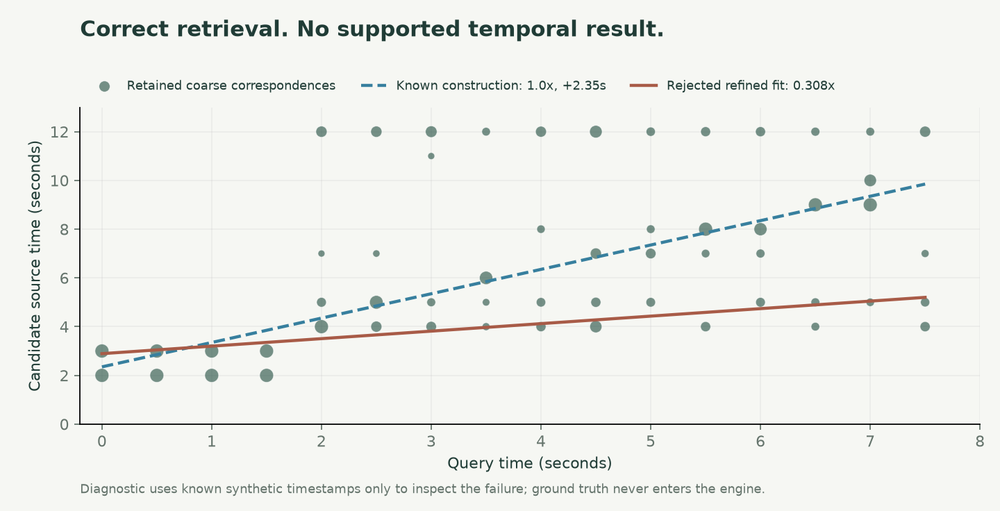
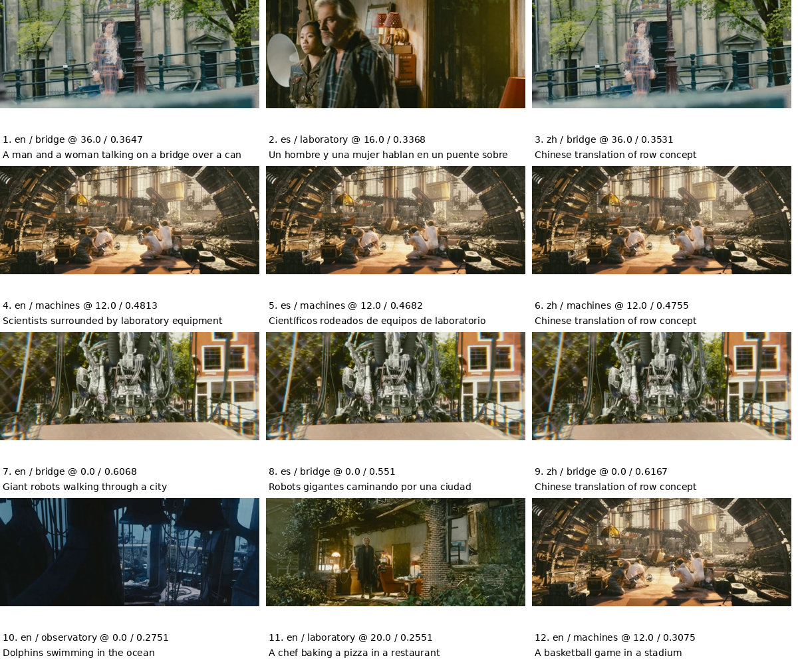

# Extended validation

These experiments extend the four-source evaluation without changing the
fingerprinted matching engine. They are reported separately: they have different
libraries and answer different questions.

## Additional-film source verification

`scripts/cross_work_validation.py` creates two 40-second excerpts of **Big Buck
Bunny**, starting at original-film seconds 100 and 300. Four predefined edits
per excerpt cover re-encoding, a fast crop, a slow mirror, and a grayscale
caption. Two negatives use unindexed intervals from the same film. The
script writes all ten constructions and input hashes to `plan.json` before
indexing or inference.

The two sources join the four bundled sources in an isolated six-source
library. The user's active library is unchanged. All returned sources,
abstentions, timing errors for recovered sources, and report hashes are retained.
The library uses actual Qwen embeddings and the same geometric/temporal engine.
This is additional-film diagnostic validation, not a population accuracy study.

## Retrieval with distractors

`scripts/retrieval_scale.py` evaluates the existing 32 positive queries against
their four target sources plus disjoint 20-second distractor clips from Tears of
Steel and Big Buck Bunny. Every complete 20-second interval is included except
Tears of Steel intervals that overlap a target source. Intervals are planned
before inference. Source titles and captions are not embedded.

This measures source rank from the pinned Qwen model, not end-to-end geometric
verification or production latency. The queries are reused from the controlled
evaluation, so this is a larger-library test, not a new held-out query study.
Every query's rank and top five candidates are retained, including failures.
Target clips are 40 seconds and distractors are 20 seconds; max pooling can
favor longer references, so this is not a length-balanced comparison.

## Reproduce

First install the project, generate the four-source index and benchmark inputs,
and download the documented original films as described in the README. For the
additional Big Buck Bunny original, use the [official Blender download](https://peach.blender.org/download/):

```bash
curl --fail --location --output data/originals/BigBuckBunny_640x360.m4v.zip \
  https://download.blender.org/peach/bigbuckbunny_movies/BigBuckBunny_640x360.m4v.zip
unzip -p data/originals/BigBuckBunny_640x360.m4v.zip BigBuckBunny_640x360.m4v \
  > data/originals/big-buck-bunny.m4v
.venv/bin/python scripts/cross_work_validation.py --output artifacts/my-cross-work
.venv/bin/python scripts/retrieval_scale.py --suite heldout-refined-v4 \
  --output artifacts/my-retrieval-scale
```

The scripts reject nonempty output directories and validate the original video
hash. The referenced benchmark suite must already exist locally; generating a
new suite with the same seed and transformations is described in the README.

- Original archive SHA-256: `7118242b6728d40c871479c5b3c0f0fb27d748089df15d7f1b469f297c74a2d6`
- Extracted video SHA-256: `738e2f999860553d056dd79c952f58f63cbb73892a57c72342ce9e5330d9d2d7`
- Extracted video bytes: 121,283,919

Big Buck Bunny is [CC BY 3.0](https://peach.blender.org/about/).
Attribution: **(c) copyright 2008, Blender Foundation / www.bigbuckbunny.org**.
Edits crop, resize, mute, mirror, recolor, caption, or change playback speed.
Original footage and intermediate videos remain local; summary measurements
and reproducible constructions are published.

## Observed abstention

The first re-encoded Big Buck Bunny query was ranked first by Qwen but returned
no verified source. The retained coarse correspondences produced a 16-frame
hypothesis whose weighted fit refined to 0.308x, below the permitted 0.35x
minimum. The temporal function therefore abstained before dense refinement.
This is a concrete failure, not a successful match with a hidden warning.



The dashed construction line is diagnostic ground truth; it never enters the
matching engine. The plotted points and fit are preserved in
`public/validation/cross-work-diagnosis.json`. Repeated candidate moments can
outvote the desired timing explanation; handling alternative fits without
accepting frozen-image false matches remains future work.

## Full verification in the expanded library

`scripts/verification_scale.py` follows the completed retrieval experiment with
four existing positive queries (one per target source, with different edits)
and two unrelated Sintel negatives. It reuses the exact source embedding
matrices and constructs the same visual descriptors as the production indexer
in an isolated workspace. The full unchanged engine then examines the expanded
library. This is a small six-case smoke test; the queries are reused and the
runtime is not a controlled latency benchmark.

```bash
.venv/bin/python scripts/verification_scale.py \
  --retrieval artifacts/my-retrieval-scale --output artifacts/my-verification-scale
```

The completed run made **6/6 correct decisions**: four correct sources and two
rejected negatives. Per-case runtime ranged from 106 to 284 seconds on the
local CPU; concurrent workloads and differing clips prevent a controlled latency
comparison. Full constructions and report hashes are published in
`public/validation/verification-scale.json`, linked by hash to the retrieval summary.

## Mixed edits and semantic-search inspection

Six additional constructions place known source intervals between unmatched
footage or black frames, concatenate two sources across an unmatched gap, and
combine a repeated still with a moving source. The unchanged engine recovered
the moving sections, including a two-second insert; it did not report the held
still as a moving source, and returned no source for the unrelated/black-only
clip. Supported sample intervals end half a second before the constructed cut;
they are evidence sample bounds, not exact editorial cut detection. The lab
interval in the two-source case retained its uncertain-speed flag. Every result
and construction is in [mixed-edits.json](../public/validation/mixed-edits.json).
These are six diagnostic cases, not an additional accuracy score.

```bash
.venv/bin/python scripts/mixed_edit_diagnostic.py --root . \
  --out artifacts/submission-kit/my-mixed-edits
python3 scripts/search_diagnostic.py \
  --out artifacts/submission-kit/my-search-inspection
```

The search script requires the local application to be running. It inspects
three scene descriptions in English, Spanish, and Chinese, plus three absent
concepts. All candidate lists are retained in
[search-diagnostic.json](../public/validation/search-diagnostic.json).



The lab descriptions retrieved a laboratory frame from the excerpt titled
“The machines,” while the robot descriptions retrieved a robot frame from
“The bridge.” Source titles are not frame-level labels and are not embedded.
The Spanish canal query instead ranked an interior frame first; this is a
visible relevance failure. The absent dolphin, pizza, and basketball concepts
also returned nearest candidates. No multilingual accuracy or scene-presence
claim is made from these qualitative observations. The interface explicitly
asks the user to inspect relevance and explains that search does not abstain
when a requested concept is absent.
